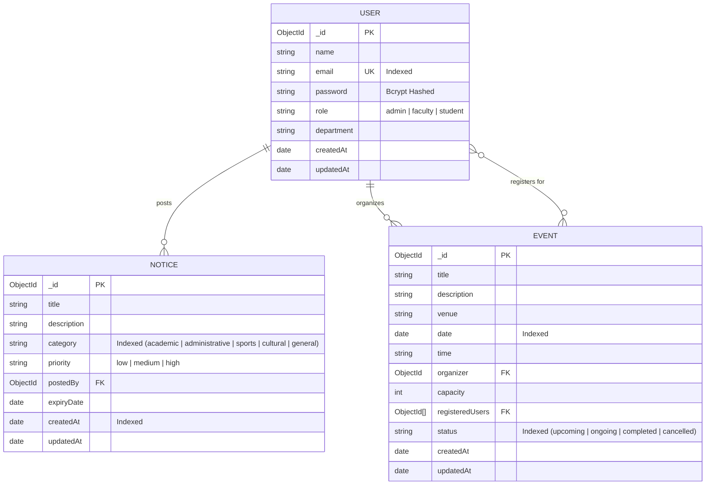

# Institutional Event & Notice Board System (CampusConnect)

A full-stack **MERN (MongoDB, Express, React + Vite, Node.js)** institutional management system designed to streamline campus communications, departmental announcements, and event lifecycle management with strict Role-Based Access Control (RBAC).

---

## 🏛️ System Roles & Permissions

| Feature / Action | Admin | Faculty | Student |
| :--- | :---: | :---: | :---: |
| **Authentication & Profile Management** | ✅ | ✅ | ✅ |
| **View Notices & Filter by Category/Priority** | ✅ | ✅ | ✅ |
| **Create Notices** | ✅ | ✅ | ❌ |
| **Update / Delete Notices** | ✅ (All) | ✅ (Own notices) | ❌ |
| **View Events & Details** | ✅ | ✅ | ✅ |
| **Create Events** | ✅ | ✅ | ❌ |
| **Update / Delete Events** | ✅ (All) | ✅ (Own events) | ❌ |
| **View Event Registrations List** | ✅ (All events) | ✅ (Own events) | ❌ |
| **Register / Unregister for Events** | ✅ | ✅ | ✅ |
| **View 'My Registrations' Page** | ✅ | ✅ | ✅ |
| **Dashboard Analytics & Aggregations** | ✅ (Global) | ✅ (Dept/Faculty stats) | ✅ (Student stats) |
| **User Role Management** | ✅ | ❌ | ❌ |

---

## 📊 Entity Relationship (ER) Diagram



---

## 🚀 Quick Start Guide

### Prerequisites
- **Node.js** (v18.0.0 or later)
- **MongoDB** (Local instance running at `mongodb://localhost:27017` or MongoDB Atlas URI)

---

### Step 1: Backend Setup & Seeding

```bash
# 1. Navigate to the server folder
cd server

# 2. Install dependencies (if not already installed)
npm install

# 3. Configure environment variables (a pre-configured .env is already present)
# Review server/.env if needed:
# PORT=5000
# MONGODB_URI=mongodb://localhost:27017/institutional_board
# JWT_SECRET=super_secret_jwt_key_12345_institutional_board
# CLIENT_URL=http://localhost:5173

# 4. Seed the database with demo users, notices, and events
npm run seed

# 5. Start the backend development server
npm run dev
# Or production mode:
npm start
```

Backend will be running at `http://localhost:5000`.

---

### Step 2: Frontend Setup

```bash
# 1. In a new terminal window, navigate to the client folder
cd client

# 2. Install dependencies (if not already installed)
npm install

# 3. Start the Vite React development server
npm run dev
```

Frontend will be running at `http://localhost:5173`.

---

## 🔑 Demo Login Credentials

The seed script (`npm run seed` inside `/server`) initializes sample accounts across all three roles.

| Role | Email | Password |
| :--- | :--- | :--- |
| **Admin** | `admin@institution.edu` | `Password@123` |
| **Faculty** | `prof.sharma@institution.edu` | `Password@123` |
| **Faculty 2** | `dr.iyer@institution.edu` | `Password@123` |
| **Student** | `aravind@student.edu` | `Password@123` |
| **Student 2** | `priya@student.edu` | `Password@123` |
| **Student 3** | `rohit@student.edu` | `Password@123` |

> *Tip: The Login page also includes 1-click **Quick Demo Autofill** buttons for instant access!*

---

## 📡 REST API Documentation

### 1. Authentication Endpoints (`/api/auth`)

| Method | Endpoint | Access | Description |
| :--- | :--- | :--- | :--- |
| `POST` | `/api/auth/register` | Public | Register new user account (`name`, `email`, `password`, `department`, `role`) |
| `POST` | `/api/auth/login` | Public | Authenticate with email and password, returns JWT token |
| `GET` | `/api/auth/me` | Private | Retrieve currently authenticated user profile |

### 2. User Endpoints (`/api/users`)

| Method | Endpoint | Access | Description |
| :--- | :--- | :--- | :--- |
| `GET` | `/api/users` | Admin | Retrieve paginated list of users with search and role filters |
| `GET` | `/api/users/:id` | Private | Retrieve user by ID |
| `PUT` | `/api/users/profile` | Private | Update current user's name, department, or password |
| `PUT` | `/api/users/:id/role` | Admin | Update user role (`admin`, `faculty`, `student`) |
| `DELETE` | `/api/users/:id` | Admin | Delete user account |

### 3. Notices Endpoints (`/api/notices`)

| Method | Endpoint | Access | Description |
| :--- | :--- | :--- | :--- |
| `GET` | `/api/notices` | Private | List notices with search, `category`, `priority`, and pagination |
| `GET` | `/api/notices/:id` | Private | Fetch single notice details populated with creator info |
| `POST` | `/api/notices` | Admin / Faculty | Create and publish notice |
| `PUT` | `/api/notices/:id` | Admin / Notice Owner | Update notice fields |
| `DELETE` | `/api/notices/:id` | Admin / Notice Owner | Remove notice |

### 4. Events Endpoints (`/api/events`)

| Method | Endpoint | Access | Description |
| :--- | :--- | :--- | :--- |
| `GET` | `/api/events` | Private | List events with search, `status`, `timeline` (upcoming/past), and pagination |
| `GET` | `/api/events/my-registrations` | Private | Get all events registered by the current user |
| `GET` | `/api/events/:id` | Private | Get single event details with organizer and attendee list |
| `POST` | `/api/events` | Admin / Faculty | Create and schedule a new event |
| `PUT` | `/api/events/:id` | Admin / Organizer | Update event information, venue, capacity, or status |
| `DELETE` | `/api/events/:id` | Admin / Organizer | Delete event |
| `POST` | `/api/events/:id/register` | Private | Register user for event (with capacity check) |
| `POST` | `/api/events/:id/unregister` | Private | Cancel user's registration for event |

### 5. Dashboard & Analytics Endpoints (`/api/dashboard`)

| Method | Endpoint | Access | Description |
| :--- | :--- | :--- | :--- |
| `GET` | `/api/dashboard/stats` | Private | MongoDB Aggregations: totals, monthly event distribution, registrations per event, category breakdown |

---

## 📁 Repository Structure

```
.
├── server/
│   ├── config/
│   │   └── db.js                 # MongoDB connection logic
│   ├── models/
│   │   ├── User.js               # User schema with bcrypt pre-save & email index
│   │   ├── Notice.js             # Notice schema with category index
│   │   └── Event.js              # Event schema with date & status indexes
│   ├── middleware/
│   │   ├── logger.js             # HTTP request logger
│   │   ├── auth.js               # JWT verification & role authorization
│   │   ├── validate.js           # Payload sanitizer & validator
│   │   └── errorHandler.js       # Centralized JSON error handler
│   ├── controllers/
│   │   ├── authController.js     # Auth handler (register, login, getMe)
│   │   ├── userController.js     # User management & profile update
│   │   ├── noticeController.js   # Notice CRUD & filtering
│   │   ├── eventController.js    # Event CRUD, registration/unregistration
│   │   └── dashboardController.js# MongoDB Aggregation pipelines
│   ├── routes/
│   │   ├── authRoutes.js
│   │   ├── userRoutes.js
│   │   ├── noticeRoutes.js
│   │   ├── eventRoutes.js
│   │   └── dashboardRoutes.js
│   ├── seed.js                   # Database seeder with demo accounts & data
│   ├── server.js                 # Express server entry point
│   ├── .env.example
│   └── package.json
├── client/
│   ├── src/
│   │   ├── api/
│   │   │   └── axios.js          # Pre-configured Axios instance with JWT interceptor
│   │   ├── context/
│   │   │   └── AuthContext.jsx   # Global session state & helper methods
│   │   ├── components/
│   │   │   ├── Navbar.jsx        # Top navigation with role badge & user menu
│   │   │   ├── Sidebar.jsx       # Responsive role-aware sidebar navigation
│   │   │   ├── Card.jsx          # Reusable card surface component
│   │   │   ├── Modal.jsx         # Modal dialogue with escape-key handling
│   │   │   ├── DataTable.jsx     # Responsive tabular view component
│   │   │   ├── Loader.jsx        # Loading spinner states
│   │   │   ├── EmptyState.jsx    # Empty placeholder state
│   │   │   └── ProtectedRoute.jsx# Role & session route guards
│   │   ├── pages/
│   │   │   ├── Login.jsx         # Login page with demo autofill
│   │   │   ├── Register.jsx      # Student & Faculty registration form
│   │   │   ├── Dashboard.jsx     # Aggregations, metrics, quick shortcuts
│   │   │   ├── Notices.jsx       # Notice board with search & category filters
│   │   │   ├── NoticeDetails.jsx # Detailed announcement view
│   │   │   ├── NoticeForm.jsx    # Create/Edit notice form
│   │   │   ├── Events.jsx        # Events feed with capacity tracker & register buttons
│   │   │   ├── EventDetails.jsx  # Event details & attendee roster (Faculty/Admin)
│   │   │   ├── EventForm.jsx     # Create/Edit event form
│   │   │   ├── MyRegistrations.jsx# Student enrolled events view
│   │   │   ├── Profile.jsx       # User profile & password settings
│   │   │   └── NotFound.jsx      # 404 page
│   │   ├── App.jsx               # Routes definition & layout composition
│   │   ├── main.jsx              # Application bootstrap
│   │   └── index.css             # Theme design system & utility classes
│   ├── index.html
│   ├── vite.config.js
│   ├── .env.example
│   └── package.json
├── .gitignore
└── README.md
```

